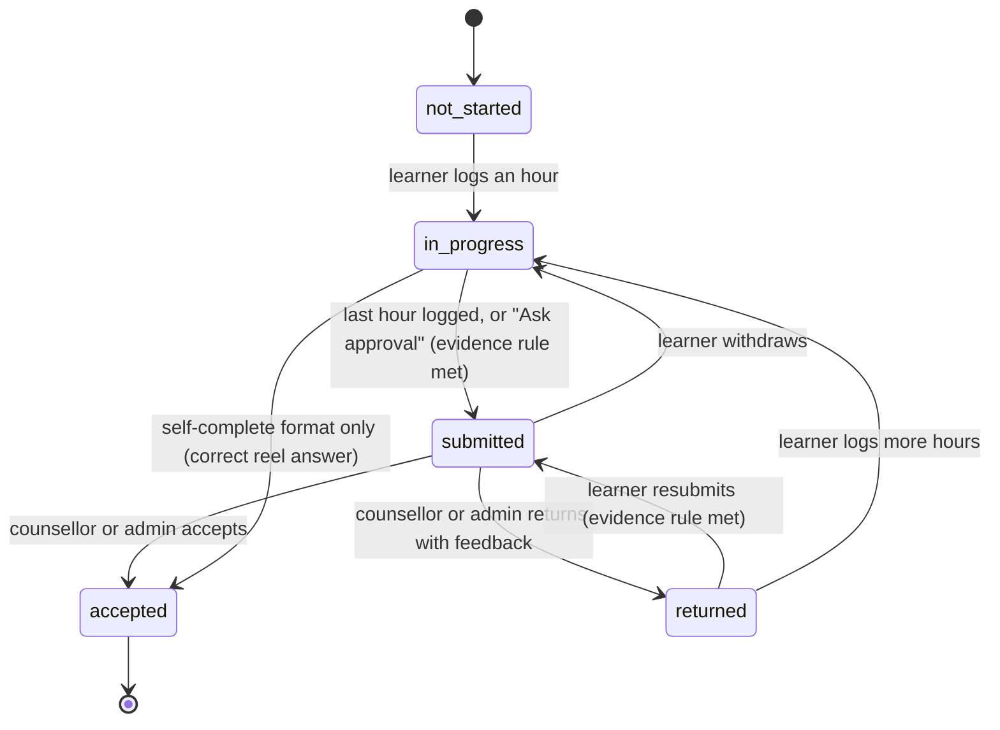
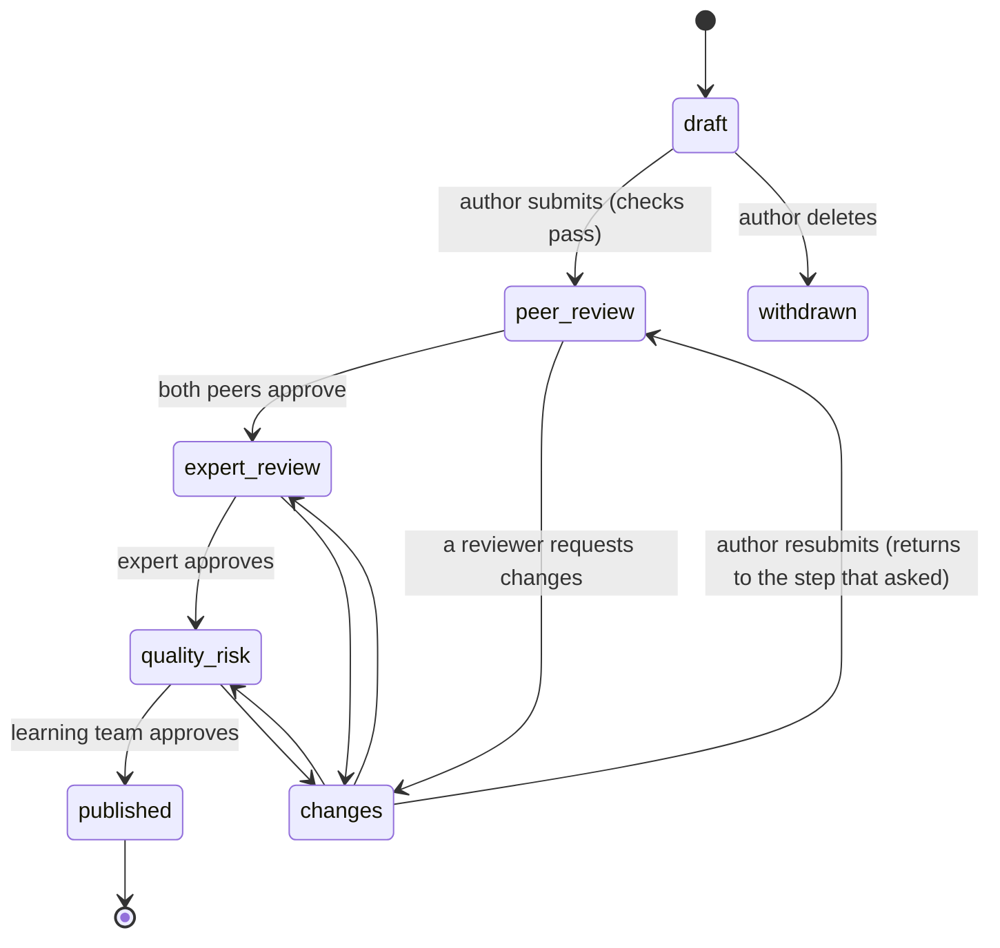
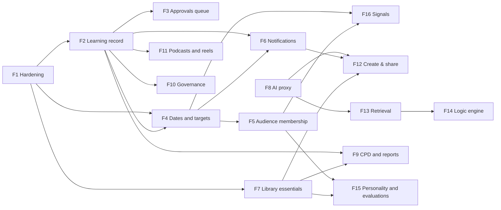

# MyProfessionalMe: functional design for the open journeys and epics

Functional design for every epic criterion and journey step that `docs/product/functional-verification.md` rates Partial, Not built or Gap. It groups them into sixteen features, each small enough to plan and test on its own, and ends with a release sequence from v0.4.1 onwards that is reconciled with `docs/superpowers/plans/2026-11-01-roadmap.md`.

## 0. Ground rules

### 0.1 The owner's answers (1 Nov 2026)

The owner answered the seventeen open questions of the product document and set one principle: **this is a proof of concept; keep it simple, but whatever exists must work and be consistent.** Every design below takes the smallest shape that closes the gap and defers anything heavy. The answers used:

| Q | Answer | Used in |
|---|---|---|
| Q1 | "Needs review" learnings are hidden from learners, like drafts | F1 |
| Q2 | A Domain Admin may map another line's published learning into their line | unchanged (Met) |
| Q3 | A correct reel answer completes the reel without a counsellor | F2, F11 |
| Q4 | Audience membership is configured by the System Admin in a matrix of roles (learner, Domain Admin, General Admin, counsellor) against audiences | F5 |
| Q5 | Readiness counts accepted hours only | F1 |
| Q6 | Next-stage targets per stage and per business line | F4 |
| Q7 | Evidence depends on the learning's format; a General Admin can also accept | F2 |
| Q8 | The counsellor sees the formal learning track, not ambitions or personality | F1, F5, F15 |
| Q9 | Ratings and notes are public to colleagues | F7 |
| Q10 | Everyone is a creator | F12 |
| Q11 | Reporting: minimal | F9 |
| Q12 | Notifications: simple | F6 |
| Q13 | Single sign-on and HR provisioning: not now | deferred |
| Q14 | Domain Admins see curriculum signals for their own line | F16 |
| Q15 | The annual hours goal varies by stage and line, configurable | F4 |
| Q16 | Avatar studio parked (later integrated with Taxatar); evaluations and personality kept simple | deferred, F15 |
| Q17 | `domain_experts` filled by System Admins, any System Admin as fallback | F12 |

### 0.2 Conventions every feature follows

These come from `CLAUDE.md` and the existing migrations; a design that breaks one is wrong.

- **Database first.** Every rule that protects data lives in RLS and `private.*` helpers (`security definer`, `set search_path = ''`, execute revoked from `public, anon`). The UI only hides what a role cannot do.
- **Grants.** Every new table starts with `revoke all … from anon, authenticated` and grants only the columns and actions the app needs (pattern: `20261030210928_tighten_table_grants.sql`).
- **One permissive policy per table and action**, merged with OR (pattern: `20261101072856_merge_permissive_policies.sql`).
- **Every policy change gets a case in `supabase/tests/rls.sql`**; every behaviour change gets a Vitest view-model test through `src/test/harness.ts`.
- **Write paths stay single.** Learner progress goes through `public.save_learning()` and `Logic.persist()` (which refuses in View as). Curriculum changes go through `Logic.applyOps()` and `publish()`. Content goes through `contentStore`.
- **No fictional people**, no secret in the client, never `user_metadata` for authorization.
- **Honest labels.** Anything not computed from real data or by a real engine carries a visible label: "Example data", "Scripted assistant", "Simulated ranking", "Not connected". Nothing a solver did not compute is shown as a solver result.

### 0.3 Roles used in the designs

| Role | How the database knows | Today |
|---|---|---|
| Member (learner) | Signed in; `auth.uid()` | Own data only |
| Counsellor | Named in someone's `profiles.counsellor_id` | Reads counsellees (`private.can_view_learner`), accepts their submissions |
| Domain Admin | `user_roles` `domain_admin` + line | Users and content of their lines (`can_manage_user`, `can_edit_content`) |
| General Admin | `user_roles` `general_admin` | All content, no users |
| System Admin | `user_roles` `system_admin` | Everything; the only role that grants roles |

Two new helpers are introduced once (in F1 and F2) and reused everywhere:

- `private.is_self(target)`: `target = auth.uid()`. Used for the private profile parts (Q8).
- `private.can_view_track(target)`: `can_view_learner(target) or is_general_admin()`. The formal learning track (progress, evidence, events, evaluations, external activities) is readable by the person, their counsellor, admins who manage them, and General Admins (needed because a General Admin may accept, Q7).

### 0.4 Size scale

S: up to one week. M: two to three weeks. L: four to six weeks. One developer working with agents, proof-of-concept quality (tested, consistent, not production-hardened).

## 1. Feature overview

| Id | Feature | Closes (main ids) | Size | Release |
|---|---|---|---|---|
| F1 | Hardening and honest copy | E2.9, E11.8, E12.9, E16.6, E16.7, E1.12, J08.7, J24.5; Q1, Q5, Q8 defects | S | v0.4.1 |
| F2 | Learning record: evidence, send-back, acceptance record | E3.6–E3.8, J02.7, J15.4, J15.6; Q3, Q7 | M | v0.5.0 |
| F3 | Approvals queue and last activity | E4.7, E4.8, J05.5, J14.5, J15.1 | S | v0.5.0 |
| F4 | Dates, targets and hours goals | E1.2, E1.4, E1.8, E5.12, E6.7, E16.4, J07.2, J07.4, J13.2, J19.6, J20.5 | M | v0.5.0 |
| F5 | Audience membership | E1.11, E5.8–E5.10, J08.6, J11.4, J18.6, J19.2, J19.4, J22.7 | M | v0.6.0 |
| F6 | In-app notifications | E15.2–E15.5, J02.8, J02.9, J04.4, J14.7, J26.7, J28.1 | S | v0.6.0 |
| F7 | Library and profile essentials | E2.6–E2.8, E11.3, J01.6, J02.4, J03.4, J03.6, J08.4 | M | v0.6.0 |
| F8 | Server-side AI proxy | E13.1, E13.4, E13.5, E5.7, E11.2, J08.2, J22.4 | M | v0.7.0 |
| F9 | CPD and minimal reports | E14.1–E14.5, E14.7, J12.1–J12.4, J23.2 | M | v0.9.0 |
| F10 | Light governance | E5.11, E6.8, E12.11, E12.13, J19.7, J23.3, J24.4 | S | v0.9.0 |
| F11 | Podcasts and reels | E9.2–E9.7 | M | v0.6.0 |
| F12 | Create & share with peer review | E8.1–E8.9, J13.4, J24.7, J26.x, J28.x | L | v0.8.0 |
| F13 | Knowledge retrieval in the database | E7.6, E7.8, E7.9, E7.14, J27.3, J27.6, J27.7, J27.10 | L | v0.10.0 |
| F14 | Logic engine and theory import | E7.11–E7.13, part of E7.10, J27.8, J27.9 | L | v0.11.0 |
| F15 | Personality results and evaluations (simple) | E1.6, E4.9, E11.5, E11.7, J09.1–J09.4, J11.1–J11.3, J16.3 | S | v0.9.0 |
| F16 | Computed curriculum signals | E5.6, J22.2; Q14 | S | v0.7.0 |

### 1.1 Deliberately not designed now

| Ids | Why |
|---|---|
| E10.2–E10.4, J10.3–J10.5 | Avatar studio parked; it will integrate with Taxatar (Q16). F1 relabels "Start a session" as "Coming with the avatar studio". |
| E12.12, J18.7 | SSO and HR provisioning: not now (Q13). |
| E3.9, E6.6, J20.2 | Program connectors need external systems. F1 labels `PROGRAMS` and the import results as example data. |
| E11.6, J09.5 | "Request an evaluation" needs the performance tool. F15 hides the button until a connector exists. |
| E4.10, J16.4 | Conversation notes: not in design or plans; the owner asked not to add scope. Revisit after the pilot. |
| E14.6 | Time to competence: computable from F2's events later; not needed for a minimal report set (Q11). |
| E11.4 (photo) | The avatar photo stays in the browser; F1 says so on screen ("Kept on this device"). |
| Most of E7.10 | Knowledge graph, query rewriting, agentic steps and the logic-driven retrieval loop are deferred; F13 keeps vector plus keyword, F14 adds the solver. |

## 2. Features

---

### F1 Hardening and honest copy (S, v0.4.1)

> **Shipped in v0.4.1 (1 Nov 2026)**, except change 8 (leaked-password protection: a dashboard switch for the owner, Auth → Passwords, available on paid Supabase plans) and change 12 (deferred: no browser test setup yet).

**Goal.** Make what exists consistent with the owner's answers and stop the app from claiming what it does not do. Closes E2.9, E11.8, E12.9, E16.6, E16.7, E1.12, J08.7, J24.5, and the Q1, Q5 and Q8 defects (verification §1.5, N1–N3, N6–N9).

**Changes.**

| # | Change | Where |
|---|---|---|
| 1 | Learners see only `published` learnings (Q1). Mappings to `review` learnings vanish for them, as for drafts. | Policy `learnings: read`: `status = 'published' or private.can_edit_content(business_line)` |
| 2 | Turning a learning into `review` is refused while another line's audience maps it, as `draft` is today. | `private.guard_shared_learning()`; `Logic.saveLearningForm()` (`foreignAudiences`) for both statuses |
| 3 | Readiness counts accepted hours only (Q5), in the map and in My team. "Hours this year" keeps logged hours but splits them: "12 h accepted · 4 h awaiting acceptance". | `Logic.readiness()`, `memberSummary()`, `readinessText` |
| 4 | Ambitions and interests are private (Q8): readable by the person only. Counsellors and admins see "Private to <first name>" in View as; the ambitions cloud of a viewed person is empty with that note. | Policies `ambitions: read`, `interests: read` use `private.is_self(user_id)`; `Logic.clouds()`; `Profile.tsx` |
| 5 | Profile copy says what is true: "Your ambitions, interests and personality results are private. Your counsellor sees your learning track: progress, evidence and acceptance." | `profLead` |
| 6 | One line rule: `memberSummary()` uses the same effective line as `Logic.bl()`, so counsellor and learner see the same readiness. | shared helper `effectiveLine(subject, config)` |
| 7 | A failed counsellee load says so: "Your counsellees did not load · Try again", badge hidden, never "Nobody has you as counsellor yet". | `useTeam` returns `{ members, error, retry }`; `Team.tsx` |
| 8 | Leaked-password protection on. | `supabase/config.toml` `[auth]`, `supabase config push` |
| 9 | RLS coverage: add the missing cases (below) and look up the System Admin id instead of hard-coding it. | `supabase/tests/rls.sql` |
| 10 | Honest copy and labels (table below). | `src/model.ts`, `src/data.ts`, `src/kbVals.ts` |
| 11 | The live copilot prompt asks for at most five operations, matching `validOps()`. | `Logic.askCp()` |
| 12 | Accessibility check: an automated axe scan of the map, library and detail at 360 px in a Playwright run, plus a keyboard-only walk-through recorded in the test catalogue (NAV-15, MAP-29). Deferred in v0.4.1 to keep it simple: the project has no browser test setup yet. | E1.12 |

**Honest copy (change 10).**

| Today | After |
|---|---|
| "Note posted · visible to colleagues on this learning" | Form hidden until F7; detail shows "Ratings and notes are not available yet". |
| "they see your evidence and the hours you logged" | "Sent to <counsellor> · they see the hours you logged" (evidence arrives with F2). |
| "Completion is logged automatically by <source> where connected" | "Log your hours here; <counsellor> accepts the result." |
| "Open items need no approval. Adding one tells <counsellor> …" | "Open items count toward your hours and levels once <counsellor> accepts them." |
| CPD fact "N · ACCA, ITAA" | "N units" (bodies arrive with F9). |
| `LENSES` "Mandatory items need Learning Council sign-off" | Sentence removed. |
| `libLead` "6 connected programs", `adminLead` "3 need attention · last sync …", `PROGRAMS` sync times, `IMPORT_RESULTS` | Program panel and import results carry an "Example data" chip; counts come from `LEARN`. |
| `road()` "since Jan 2026" | "accepted so far". |
| Signal cards (`SIGNALS`) | "Example signal" chip until F16 replaces them. |
| Audience reach (`AUDS`, `STAGE_FR`) | "Estimated" chip until F5 replaces it. |
| Knowledge library: random passage counts, `disp` similarity, re-index timer, `'3 Mar'` staleness | "Simulated" chip on the status, passage count and similarity; until F13 a new source shows "Not indexed" instead of a random count. |
| "Start a session" avatar toast | "Coming with the avatar studio". |
| "Kept in this browser" photo | "Kept on this device only". |

**New rls.sql cases.** A learner cannot read a `review` learning or a mapping to one; a counsellor cannot read a counsellee's ambitions or interests; a Domain Admin cannot read a managed user's ambitions; a member cannot insert, update or delete another person's interests or `learner_prefs`; a Domain Admin cannot insert or delete another line's bundle; a Domain Admin and a System Admin can accept a submitted item of a managed user; a counsellor cannot read a non-counsellee's progress; `profiles_not_own_counsellor` refuses a self-assignment; a Domain Admin cannot turn a learning mapped by another line into `review`.

**Acceptance criteria.**

- Given a learner and a `review` learning, when the catalogue loads under RLS, then the learning and its mappings are absent (rls.sql).
- Given a Consulting Analyst with one submitted and one accepted mandatory item, when the map renders, then readiness counts only the accepted item's hours, and My team shows the same percentage (Vitest `model.map.test.ts`, `logic/team.test.ts`).
- Given a counsellor viewing a counsellee with two ambitions, when the profile renders, then it shows "Private to <first name>" and no ambition text (rls.sql + Vitest).
- Given `useTeam` fails, when My team renders, then it shows the error and "Try again" and the badge is hidden (Vitest `screens.test.tsx`).
- Given a counsellee without a business line, when the counsellor's roster and the counsellee's map render, then both show the same readiness (Vitest).

**Risks.** Hiding `review` learnings can remove items from paths that learners already started; their progress stays and reappears on publication. **Open question:** none.

---

### F2 Learning record: evidence, send-back and acceptance record (M, v0.5.0)

**Goal.** Completions count only once accepted, with the evidence the format needs, a way to return work with feedback, and a durable record of who did what and when. Closes E3.6, E3.7, E3.8, J02.7, J15.4, J15.6; implements Q3 (self-completing reels) and Q7 (evidence per format, General Admin accepts). Provides the event history that F3, F6, F9 and F10 read.

**Actors and permissions.**

| Action | Who | Enforced by |
|---|---|---|
| Log hours, submit, withdraw a submission, attach or remove evidence before acceptance | The learner | `save_learning`, guard trigger, evidence policies |
| Accept or return a submission | Counsellor, managing Domain Admin, System Admin, **General Admin** (Q7); never the learner | `private.can_accept()` extended with `is_general_admin()` |
| Self-complete | The learner, only for formats whose rule says so (Reel, Q3) | guard trigger via `private.is_self_complete()` |
| Read progress, evidence, events | `private.can_view_track()` | policies |

**State model.**

**Format rules (Q7).** A small table, edited by General and System Admins in the admin library ("Formats" panel):

| Format | Evidence required to submit | Self-complete |
|---|---|---|
| Certification | File or link (certificate) | No |
| Classroom | None (attendance is confirmed by the accepter) | No |
| E-learning | None | No |
| Book, Website | Short reflection (≥ 140 characters) | No |
| Mentoring, Game | Short reflection | No |
| Avatar | None (parked) | No |
| Reel | None | Yes |
| Podcast | None | No |

These defaults are a proposal; the owner confirms them (open question F2-a).

**Main flow (learner).** Detail → "Log 1 hour" until 100% → the detail shows "Add evidence" when the format requires it ("Add a certificate (PDF or image, ≤ 5 MB) or a link", or "Write what you took from it") → "Submit for acceptance" is enabled once the rule is met → state `submitted`, toast names the accepter. The learner can "Withdraw" while `submitted`.

**Main flow (accepter).** View as → detail of a submitted learning shows the evidence (link, reflection, or file opened through a short-lived signed URL) and two actions: "Accept" and "Return with feedback" (feedback required, 10–500 characters). Accepting records `accepted_by` and `accepted_at`; returning sets `returned` and stores the feedback, shown to the learner on the detail and the map dock ("Returned by <name>: <feedback>").

**Alternative and error paths.** Submit without required evidence: refused in the UI and by the database ("This format needs a certificate or link"). Second accepter or double click: "This learning is no longer waiting for acceptance" (today's DET-18). File too large or wrong type: refused before upload. Evidence upload fails: the submission is not sent; message with retry. View as: every learner action refuses through `persist()`.

**Data.**

| Object | Change |
|---|---|
| `learner_learnings` | `state` check adds `returned`; new columns `submitted_at`, `accepted_at`, `accepted_by` (→ `profiles`, on delete set null), `feedback text`, `returned_at`. Learners may not write the new columns (column grants); the guard sets them. |
| `learning_events` (new) | `id`, `user_id`, `learning_id`, `kind` (`logged`, `submitted`, `withdrawn`, `returned`, `accepted`, `self_completed`, `chosen`, `unchosen`), `actor_id`, `at`, `detail jsonb` (pct, feedback). Written only by an `after update or insert` trigger on `learner_learnings` (`security definer`); no insert grant to `authenticated`. Read: `private.can_view_track(user_id)`. |
| `learning_evidence` (new) | `user_id`, `learning_id`, `kind` (`link`, `note`, `file`), `url`, `note`, `file_path`, `created_at`; one row per item. Insert and delete: the owner while the progress row is not `accepted`. Read: `private.can_view_track(user_id)`. |
| Storage bucket `evidence` (private) | Path `<user_id>/<learning_id>/<file>`. Storage policies mirror `learning_evidence`. |
| `format_rules` (new) | `format pk`, `evidence text check in ('none','note','link_or_file')`, `self_complete boolean`. Read: all signed in. Write: General and System Admins. |
| `private.guard_learning_update()` | Owner: may move between `not-started`, `in-progress`, `submitted`, `returned`; may enter `accepted` only when `private.is_self_complete(learning_id)`; entering `submitted` checks `private.evidence_ok(user, learning)`. Others: only `submitted → accepted` or `submitted → returned` (with non-empty feedback), nothing else changes. Sets `submitted_at`, `accepted_at`, `accepted_by`, `returned_at`. |
| `private.can_accept()` | Adds `or private.is_general_admin()`; still never the person. |
| `profiles: read`, `learner_learnings: read` | Use `private.can_view_track()` so General Admins can open a person in View as (Q7). |

Retention: events and evidence live as long as the account; removing a person cascades. Evidence files are deleted with the row (storage cleanup in the same edge call as `remove`).

**Acceptance criteria.**

- Given a Certification in progress at 100% with no evidence, when the learner submits, then the UI refuses and a direct `save_learning(state => 'submitted')` raises the evidence error (Vitest + rls.sql).
- Given a submitted learning, when the counsellor returns it with feedback, then the state is `returned`, the learner's detail shows the feedback, and an event `returned` exists with the counsellor as actor (rls.sql + Vitest).
- Given a submitted learning, when a General Admin accepts it, then `accepted_by` is the General Admin and `accepted_at` is set (rls.sql).
- Given a learner, when they try to set `accepted_by` or `accepted_at` themselves, then the update is refused (rls.sql).
- Given a Reel, when the learner's correct answer saves `accepted`, then it is allowed and the event is `self_completed`; given a Classroom item, the same write is refused (rls.sql).
- Given a counsellor in View as, when they open a submitted learning, then evidence is listed and "Accept" and "Return with feedback" are offered; feedback under 10 characters is refused (Vitest).

**Dependencies.** F1 (readiness on accepted only). **Risks.** File evidence adds Storage, the first in the project; keep the bucket private and test the storage policies in `rls.sql`. **Open questions.** F2-a: confirm the format rules table. F2-b: may a General Admin read every person's formal track (needed to accept), or only people who have a submission waiting?

---

### F3 Approvals queue and last activity (S, v0.5.0)

**Goal.** Counsellors and admins find what waits for them without opening each person, and see who is inactive. Closes E4.7, E4.8, J14.5, and the queue half of J05.5 and J15.1.

**Design.**

- **"Waiting for you" panel** at the top of My team, listing every `submitted` learning the signed-in person may accept: their counsellees, plus, for admins, people they manage without a counsellor. General Admins see submissions of people without a counsellor (F2-b decides the wider scope). Each row: person, learning, format, evidence icon, submitted date, days waiting (amber after 5 working days). "Open" switches View as to the person and opens the detail.
- **Last activity column** in the roster: the latest `learning_events.at` for that person ("Yesterday", "3 weeks ago", "No activity yet").
- **Sidebar badge** on My team: overdue counsellees (today) plus waiting submissions, shown as two numbers ("2 · 3 waiting").
- **Data.** A `security invoker` function `public.waiting_submissions()` returns rows the caller can read under RLS where `state = 'submitted'` and `private.can_accept(user_id)`. No new table.

**Acceptance criteria.** Given a counsellor with two counsellees, one with a submission, when My team opens, then "Waiting for you" lists exactly that one with its days waiting (Vitest). Given a Domain Admin, then submissions of their line's people without a counsellor are listed and other lines' are not (rls.sql on `waiting_submissions()`). Given a counsellee whose last event was 21 days ago, then the roster reads "3 weeks ago" (Vitest).

**Dependencies.** F2. **Risks.** None. **Open questions.** None.

---

### F4 Dates, targets and hours goals (M, v0.5.0)

**Goal.** Deadlines are real dates set per mandatory mapping; next-stage targets and the annual hours goal depend on stage and line; the road rolls with today. Closes E1.2, E1.4, E1.8 (year), E5.12, E6.7, E16.4, J07.2, J07.4, J13.2, J19.6, the deadline half of J20.5; fixes N5 and N11.

**Design.**

- **Deadline per mandatory mapping.** `curriculum_mappings.due_date date`, allowed only when `obligation = 'mandatory'` (check constraint). In Curriculum mapping, the dock of a selected mandatory card gets a date field "Deadline"; it goes through `applyOps()` as a new op `setDue` and publishes with the rest. A date in the past is refused for new values. Advised mappings never carry a date.
- **One learner deadline.** A learner's deadline for a learning is the earliest `due_date` among the mandatory mappings that reach them (their line and, after F5, their industry and technology audiences). The admin library's learning form shows these deadlines read-only ("Deadlines are set per audience in Curriculum mapping"), which closes E6.7 by moving the field where it belongs.
- **Migration.** The four free-text values in `learnings.due` ("30 Nov 2026", "Jan 2027", "Mar 2027", "Jun 2027") are converted once to dates on every mandatory mapping of that learning (month-only values become the month's last day); `learnings.due` is then dropped. `dueQuarter()` and `deadline()` are replaced by one date helper.
- **Overdue for the learner.** Detail, cards and Next up show "Overdue since 30 Nov" in red when a mandatory item is past its date and not accepted; "Due soon" means within 30 days (no literal dates).
- **Rolling road.** Four quarters starting with the current quarter, plus a "Later" column; overdue items sit first in the current quarter with an "Overdue" tag.
- **Stage expectations (Q6, Q15).** One table `stage_expectations(stage, business_line null, targets smallint[9], annual_hours numeric, mandatory_budget numeric)`; a `null` line is the firm default. Resolution: line row, else firm row, else the built-in `TARGET` and 80 h / 40 h. Map hubs, radar, zoom, detail ladder, My team footer (one row per stage present in the team), the hours chip ("of 60 h this year") and the learner's eye budgets all read it. Editing: a "Stage expectations" tab in Curriculum mapping, a grid of stages × domains with level selects, plus the two hour fields; General and System Admins edit the firm row and every line; a Domain Admin edits their line's rows (`private.can_edit_content(business_line)`).
- **Hours this year** counts accepted hours with `accepted_at` in the calendar year (from F2), plus logged-but-not-accepted hours shown separately.

**Data and permissions.** `curriculum_mappings.due_date` follows the existing mapping policies. `stage_expectations`: read by all signed in; insert, update, delete by `private.can_edit_content(business_line)`; unique `(stage, business_line)` with `nulls not distinct`; `targets` has exactly nine values between 1 and 5.

**Acceptance criteria.**

- Given a mandatory mapping, when an admin sets a deadline in the dock and publishes, then `due_date` is stored and every learner it reaches sees "Due <date>" (Vitest `model.mapping.test.ts` + rls.sql: a Domain Admin cannot set it on another line's mapping).
- Given an advised mapping, when a `due_date` is written directly, then the constraint refuses it (rls.sql).
- Given today is 15 Feb 2027, when the road renders, then its columns are Q1 2027 to Q4 2027 plus "Later" (Vitest with fake timers).
- Given an Audit Senior consultant and an Audit row for Manager with different targets than the firm row, when the radar renders, then it uses the Audit Manager targets (Vitest).
- Given a mandatory item due yesterday and not accepted, when the learner opens the library, then the card reads "Overdue since <date>" (Vitest).

**Dependencies.** F2 for dated hours (the rest stands alone). **Risks.** Data migration of `due`; covered by a migration test that converts the four seed values. **Open questions.** F4-a: are recurring obligations (GDPR every two years) needed in the pilot, or is one date per mapping enough? (Design assumes one date.)

---

### F5 Audience membership (M, v0.6.0)

**Goal.** People belong to industry, technology, ambition and profile audiences, and what admins map to those audiences reaches them. Closes E1.11, E5.8, E5.9, E5.10, J08.6, J11.4, J18.6, J19.2, J19.4, J22.7.

**Who sets membership (Q4).** The System Admin maintains a matrix in User management ("Audience rights"): rows are the lenses Industry, Technology, Ambition, Profile; columns are the roles Learner (the person themself), Counsellor (for their counsellees), Domain Admin (for people they manage), General Admin (for anyone). System Admins can always set membership. Proposed defaults:

| Lens | Learner | Counsellor | Domain Admin | General Admin |
|---|---|---|---|---|
| Industry | no | yes | yes | yes |
| Technology | yes | yes | yes | yes |
| Ambition | yes | no | no | no |
| Profile | yes | no | no | no |

Ambition and Profile stay learner-only by default because the counsellor must not see those parts (Q8); the matrix screen warns when a System Admin ticks Counsellor or an admin role for them.

**Flows.**

- **Learner:** Profile → "My audiences": chips per lens the matrix allows them to set; "+ Join" lists that lens's audiences; "Leave" removes. Saving an ambition suggests the matching ambition audience ("Join *Sustainability lead* to receive its suggestions?").
- **Counsellor and admins:** User management row (admins) or My team row (counsellor) → "Audiences" → the same chips, for the lenses the matrix allows the caller.
- **Effect on the learner:** `Logic.mapping()` stacks the business line and every audience the person belongs to. Obligation precedence: mandatory beats advised; the earliest stage wins; a learning arriving twice counts once and shows "via Consulting and Energy & utilities". Industry and Technology mappings count toward readiness and deadlines like the business line; Ambition and Profile mappings are suggestions only: they appear dashed in the ambitions or personality cloud and never count toward readiness (`LENSES` policy, constraint `curriculum_mappings_advised_lenses`).
- **Learner's eye:** `mePersona()` becomes the person's real audiences (any number per lens), so the stack, budget and duplicates are real.
- **Reach (E5.10):** coverage grid and dock use real counts per audience and stage from a `security definer` function `public.audience_reach()`; counts below 5 read "fewer than 5". For the business line it counts profiles per line and stage. Replaces `AUDS` reach and `STAGE_FR`.

**Data.**

| Object | Content | Policies |
|---|---|---|
| `audience_members` | `user_id`, `audience` (same check as mappings, lens audiences only), `set_by`, `set_at`; pk `(user_id, audience)` | Read: `is_self(user_id)` or `private.can_set_membership(user_id, audience)`. Insert and delete: `private.can_set_membership(user_id, audience)` |
| `audience_rights` | `lens`, `role`; pk `(lens, role)` | Read: signed in. Write: System Admins |
| `private.can_set_membership(target, audience)` | System Admin; or the matrix allows the caller's relation to `target` for the audience's lens | — |
| `public.audience_reach()` | Counts per audience × stage, suppressing values under 5 | `security definer`, admins only |

**Acceptance criteria.**

- Given a Consulting Senior consultant who joins Energy & utilities, when the map renders, then the `ind:energy` mandatory item L18 counts toward readiness and appears once even though Consulting maps it too (Vitest `model.map.test.ts`).
- Given an ambition audience mapping, when a member's readiness is computed, then it is unchanged; the item appears in the ambitions cloud (Vitest).
- Given the default matrix, when a counsellor adds a counsellee to `amb:sust`, then it is refused; when they add them to `tec:data`, it is stored (rls.sql).
- Given a counsellor, when they read `audience_members` of a counsellee, then ambition and profile rows are not returned under the default matrix (rls.sql).
- Given an audience with 3 members at Analyst, when the coverage grid renders, then the cell reads "fewer than 5 people" (Vitest with a stubbed reach).

**Dependencies.** F1 (privacy), F4 (deadlines from industry and technology mappings). **Risks.** A stack with several audiences may exceed the mandatory budget; F16's Load signal surfaces it. **Open questions.** F5-a: is the matrix per lens (as designed) or per individual audience? F5-b: confirm the defaults above.

---

### F6 In-app notifications (S, v0.6.0)

**Goal.** The right person hears about the right event, in the app only (Q12). Closes E15.2–E15.5, J02.8, the message halves of J02.9, J05.5, J15.1, J26.7, J28.1, and J04.4, J14.7.

**Design.**

- A bell in the header with the unread count; a drawer lists notifications newest first, with "Mark all read". Clicking one opens its target (for a counsellee's learning, View as switches to that person). Notifications are about the signed-in person, never the viewed subject.
- **Events and recipients** (created by triggers on `learning_events` and, later, contribution reviews; no client inserts):

| Event | Recipient |
|---|---|
| Learning submitted | The counsellor; without a counsellor, the Domain Admins of the person's line |
| Accepted / returned | The learner (with the feedback) |
| Review assigned, changes requested, contribution published (F12) | Reviewer / author |
| "Nudge" from My team on an overdue item | The counsellee ("<counsellor> reminds you: <learning> was due <date>"), at most once per learning per 7 days |
| "Ask an admin to set my line and stage" (sidebar card when missing) | The person's line's Domain Admins; without a line, the System Admins |

- **Deadline reminders** are computed, not stored: the drawer's top section "Due soon" lists the person's mandatory items due within 30 days or overdue (from F4). No scheduler, no email.
- **Data.** `notifications(id, user_id, kind, title, body, link jsonb, created_at, read_at)`. Read and update (`read_at` only): `is_self(user_id)`. Insert: none for `authenticated`; written by `security definer` functions `private.notify(...)` called from triggers and from `public.nudge(counsellee, learning)` (checks the caller is the counsellor and the 7-day limit) and `public.ask_for_setup()`. Rows older than 90 days are deleted at sign-in of their owner (a one-line cleanup in `ask_for_setup`-style function) to keep the proof of concept free of schedulers.

**Acceptance criteria.** Given a learner without a counsellor in Audit, when they submit, then each Audit Domain Admin gets one notification and nobody else (rls.sql + trigger test). Given a counsellor, when they nudge the same overdue item twice within 7 days, then the second call is refused with "Already reminded on <date>" (rls.sql). Given a learner with an item due in 10 days, when the drawer opens, then "Due soon" lists it (Vitest). Given a notification of another user, when read directly, then no row returns (rls.sql).

**Dependencies.** F2 (events), F4 (dates). **Risks.** Without email, people who rarely sign in miss things; acceptable for the pilot. **Open questions.** None (Q12 answered).

---

### F7 Library and profile essentials (M, v0.6.0)

**Goal.** Close the small gaps users notice first. Closes E2.6, E2.7, E2.8, E11.3, J01.6, J02.4, J03.4, J03.6, J08.4, the link half of J20.5.

**Design.**

| Item | Flow and rules | Data |
|---|---|---|
| **Ratings and notes** (Q9 public) | Detail → "Rate & leave a note" for anyone who has started the learning (state not `not-started`). One rating (1–5) and an optional note (≤ 500 characters) per person per learning; editable; deletable by the author. The detail shows the average and count, and notes newest first with the colleague's name and stage. Notes are checked against the blocked-terms list of F12 (client names); a hit is refused with the term named. A General or System Admin can hide a note ("Hidden by an admin"). | `learning_ratings(user_id, learning_id, rating, note, created_at, updated_at, hidden boolean)`, pk `(user_id, learning_id)`. Read: signed in, `not hidden or is_self or admin`. Insert/update/delete: `is_self(user_id)` and a progress row exists. Hiding: `public.hide_rating()` (`security definer`, General/System Admin). |
| **Remove from my path** | Detail of a `chosen` learning → "Remove from my path" saves `chosen: false` through `save_learning`; logged hours stay; accepted items stay accepted. | none |
| **Launch link** | Admin library form gets "Link" (https only). Detail shows "Open in <source> ↗" when set. | `learnings.url text check (url ~ '^https://')`, added to the column grants |
| **Add an ambition or interest directly** | Profile → "+ Add ambition" (text, horizon 1/3/5 years, up to three domains) and "+ Add interest" (label, domain). Both go through `persist()`; duplicates of an interest label (any case) are refused. | existing tables |
| **First-week checklist** (J01.6) | A card on the growth map for people who have not finished it: "Read what your next stage expects" (open the radar), "Open your first mandatory item", "Log your first hour", "Add an interest". Steps tick from real data; "Hide" stores the choice. | `learner_prefs.onboarding_hidden boolean` |

**Acceptance criteria.** Given a learner who has not started L5, when they try to rate it, then the UI hides the form and a direct insert is refused (rls.sql). Given three ratings, when another learner opens the detail, then the average and three notes with names are shown (Vitest). Given a hidden note, then other learners do not see it, the author does (rls.sql). Given a chosen item, when the learner removes it, then `chosen` is false and its hours stay (Vitest). Given a learning with a link, then the detail offers "Open in <source>" (Vitest). Given a typed ambition with no domain, when saved, then it is refused with "Pick at least one domain" (Vitest).

**Dependencies.** F1. F12's blocked-terms table is created here first if F7 ships earlier. **Risks.** Public notes need moderation; hiding by admins covers the pilot. **Open questions.** None.

---

### F8 Server-side AI proxy (M, v0.7.0)

**Goal.** The four assistants (profile chat, curriculum copilot, learner's eye, test retrieval answer) work outside Claude Design through a server-side proxy; the key is never in the client. Prerequisite of F12's "Draft with AI" and F13/F14. Closes E13.1, E13.4, E13.5, E5.7, E11.2, J08.2, J22.4, and the answer half of E7.6.

**Design.**

- **One edge function `assistant`**, called with the user's session token. Input: `task` (`profile_chat`, `copilot`, `learners_eye`, `kb_answer`, later `draft_outline` and `logic_translate`) and task fields. The function holds the system prompts that live in `Logic` today (`sysPrompt()`, the copilot and learner's-eye prompts, the retrieval prompt), so the client can no longer change them.
- **The assistant sees only what the caller may see (E13.4).** The function reads context with the caller's token, under RLS: the caller's own ambitions and interests for the profile chat (never another person's, Q8); for the copilot, the catalogue and mappings and a role check (admins only); for the learner's eye, it verifies `can_view_track(subject)` before using the stack the client sends (titles and hours only); for `kb_answer`, it re-reads the bundle under RLS and drops client and licensed passages again. No service-role key is used for reading user data.
- **Validated output.** The model is asked for structured JSON; the function validates it with the same rules as today (`validOps()`: known audience, known learning, at most five operations, never mandatory for ambition or profile audiences; interests in known domains; ambition domains filtered) and returns it. Any failure returns `{ fallback: true }` and the client uses the existing scripted reply; the subtitle says "Scripted assistant" whenever that happened.
- **Limits and logging (E13.5).** `ai_usage(user_id, day, calls, input_tokens, output_tokens)`, updated by the function; 100 calls per person per day (a setting). Over the limit, the client gets the scripted reply with "Daily assistant limit reached". The function logs task, duration, tokens and outcome, never prompt or answer text; rows older than 90 days are deleted by the function itself.
- **Model and region.** The model id and region are function settings, not code. EU processing is an owner decision: according to current Anthropic documentation (to verify at build time), the first-party API's inference-geography setting offers "global" or "us" only, so EU-only processing means calling Claude through an EU region of a cloud provider (Google Vertex AI in an EU region or Amazon Bedrock in an EU region). This choice is separate from the E5 embedding host of F13, which the roadmap already fixes as self-hosted in the EU.
- **Claude Design keeps working.** When `window.claude.complete` exists (inside Claude Design) the app may still use it; elsewhere it calls `assistant`.

**Labels.** "AI assistant" when the answer came from the proxy, "Scripted assistant" when it fell back; test retrieval reads "Answer drafted by Claude from N passages · ranking: simulated keyword" until F13.

**Acceptance criteria.** Given the proxy returns an operation on `amb:sust` marked mandatory, when the copilot proposal is shown, then it is advised (Vitest with a stubbed `assistant`). Given the proxy fails or times out (10 s), when the learner chats, then the scripted reply appears and the subtitle says "Scripted assistant" (Vitest). Given a member calls the `copilot` task, then the function returns 403 (function test). Given the profile chat, when a counsellor calls it while viewing a counsellee, then it is refused (View as is read-only today, and the function checks `is_self`). Given 100 calls today, when the 101st arrives, then the client shows the limit message (function test). The project has no edge-function tests today; F8 adds a Deno test file for `assistant` next to the function (`deno test`, model call stubbed), the first piece of new test infrastructure in this plan. The shared validation (`validOps()` and the interest and ambition filters) moves to one module that both Vitest and the Deno test import.

**Dependencies.** None in the app; an Anthropic or cloud account and the owner's region decision. **Risks.** Cost and latency; the daily limit caps both. **Open questions.** F8-a: which EU route (Vertex AI EU or Bedrock EU), or accept "global" processing for the pilot?

---

### F9 CPD and minimal reports (M, v0.9.0)

**Goal.** A person can declare their CPD per professional body, and admins get two small reports, without a reporting engine (Q11). Closes E14.1, E14.2, E14.3, E14.4 (minimal), E14.5, E14.7, J12.1–J12.4, J23.2, the CPD half of E1.8.

**Design.**

- **CPD body per learning.** `learnings.cpd_body text check in ('ITAA','IBR-IRE','ACCA','Other')`, required when `cpd > 0`; admin form field. One body per learning keeps it simple.
- **External activities (J12.3).** Profile → "Other learning" → "+ Add": title, provider, date, hours, CPD units, body, link or note as evidence. Self-declared and labelled so; part of the formal track (`can_view_track`), so the counsellor sees it. Counts toward hours and CPD, never toward readiness or levels.
- **CPD statement (J12.4).** Profile → "CPD statement" → pick a year → table of accepted learnings (`accepted_at` in the year) and external activities, totals per body, "Download CSV" (built in the browser).
- **Library filter "Carries CPD"** with a body select (J12.2).
- **Reports screen** (Administration → Reports) for Domain Admins (their lines), General and System Admins (all):
  1. **Mandatory completion** per line × stage: people, mandatory items assigned, accepted, overdue.
  2. **Readiness** per line × stage: people, share at 80% or more, median.
  3. **Learning use** per learning: people started, accepted, average rating (F7), mapped audiences.
  Computed in the browser with the existing `memberSummary()` over the people the caller can read (the same loader as My team), labelled "Computed from N people you can see". Any cell describing fewer than 5 people reads "fewer than 5" (E14.7). Each table downloads as CSV. Curriculum load (E14.5) is the existing coverage grid plus F5's real reach.

**Acceptance criteria.** Given a learning with CPD and no body, when saved, then the form refuses it (Vitest + check constraint). Given two accepted learnings in 2027 and one external activity, when the 2027 statement opens, then totals per body add up and the CSV has three rows (Vitest). Given a line × stage group of 4 people, then the report cell reads "fewer than 5" (Vitest). Given a Domain Admin of Audit, then the reports contain Audit only (Vitest over RLS-shaped data).

**Dependencies.** F2 (`accepted_at`), F4 (dates, overdue), F7 (ratings). **Risks.** Browser computation is fine at pilot scale (hundreds of people), not beyond. **Open questions.** None.

---

### F10 Light governance (S, v0.9.0)

**Goal.** Traceable changes to roles, assignments and curricula; a person can take their data; stale catalogue items are visible. Closes E5.11, E6.8, E12.11, E12.13, J19.7, J23.3, J24.4.

**Design.**

- **Audit log.** `audit_log(id, at, actor_id, action, target_user, detail jsonb)`, written by triggers on `user_roles` (grant, revoke), `profiles` (line, stage, counsellor), `curriculum_mappings` (insert, update, delete with old and new values) and `learnings` (status change, delete). No client writes. Read: System Admins all rows; Domain Admins rows whose `target_user` they manage or whose mapping audience they edit. Shown as "History" in User management (per person) and in Curriculum mapping (per audience).
- **Undo a mapping change (J19.7).** A history row of a mapping change offers "Restore previous": it turns the old value into a pending change through `applyOps()`, to be published normally (no special rollback path).
- **Download my data (E12.13).** Profile → "Download my data": a JSON file with profile, progress, events, evidence list, ambitions, interests, ratings, external activities, personality results; built in the browser from what RLS already lets the person read. Retention: data lives until the account is removed; removal deletes it (existing cascade) and keeps audit rows with `actor_id`/`target_user` set to null.
- **Catalogue owner and review date (E6.8).** `learnings.review_by date` (default one year after publishing) and the existing `created_by` shown as owner; the admin library gets a "Review due" status filter and an amber chip on overdue items. Publishing again sets a new `review_by`.

**Acceptance criteria.** Given a System Admin grants a Domain Admin role, then one audit row names the actor and target (rls.sql). Given a Domain Admin of Consulting, then audit rows about Audit people are not returned (rls.sql). Given a mapping changed from mandatory to advised, when "Restore previous" is clicked, then a pending `setOb mandatory` exists and nothing is written until publish (Vitest). Given a learning with `review_by` in the past, then the admin library flags it and the "Review due" filter lists it (Vitest).

**Dependencies.** F2 (trigger pattern). **Risks.** None. **Open questions.** None.

---

### F11 Podcasts and reels (M, v0.6.0; Roadmap §2)

> **Shipped in v0.5.0 (2 Nov 2026)**, ahead of F2–F4 at the owner's request. Self-completion follows the format, as designed here, through `private.is_self_complete()` reading `learnings.format`.

**Goal.** Short formats that fit a project week. Closes E9.2–E9.7.

**Design.** Rebase `feature/design-v3-b` onto `main` as the roadmap says, with three changes:

- **Self-completion through the format rule, not a list of ids.** A correct reel answer saves `accepted` through `save_learning`; the guard of F2 allows it because `format_rules.self_complete` is true for Reel (Q3). New reels need no migration. View as plays but never saves (`persist()`).
- **Media in the database.** `learning_media(learning_id pk, kind 'podcast'|'reel', media_url, duration_sec, chapters jsonb, question jsonb, transcript text, captions_url)`, read by all signed in, written by `can_edit_content(line of the learning)`. L42–L48 move there with the seed script. Media files stay where they are hosted (URLs); no upload in this feature.
- **Accessibility (E9.7).** A podcast or reel cannot be published without a transcript; reels also need captions. Enforced in the admin form and by a trigger on `learnings` status change.

The player stops when the learning or the subject changes (plan Task 3, `usePlayer` key).

**Acceptance criteria.** As in v3-remaining Task 3, plus: given a reel without captions, when an admin publishes it, then it is refused (Vitest + rls.sql). Given a correct answer on a reel by the learner, then the row is `accepted` with event `self_completed`; given the same write on a Podcast, then it is refused (rls.sql).

**Dependencies.** F2 (format rules, guard). **Risks.** Rebase conflicts with `main`'s covers and zoom (the roadmap already plans for it). **Open questions.** None (Q3 answered).

---

### F12 Create & share with peer review (L, v0.8.0; Roadmap §3)

**Goal.** Anyone (Q10) turns a project lesson into a reel, podcast, micro-guide or case write-up, grounded in firm knowledge, reviewed by two peers, a domain expert and the learning team, and published into the catalogue. Closes E8.1–E8.9, J13.4, J24.7, J26.1–J26.9, J28.1–J28.6.

**Scope cut for the proof of concept.** The design's fifth type, "Avatar scenario", waits for the avatar studio (Q16).

**State model.**

**Actors and routing.**

| Step | Reviewer | Rule |
|---|---|---|
| Peer review | Two people who share the contribution's domain as an interest or share the author's line | Never the author, never the author's counsellor, never someone the author counsels; fewer than two candidates: any member of the author's line; still none: a System Admin |
| Expert review | The domain's expert from `domain_experts` (System Admins maintain it in User management) | None set: any System Admin (Q17) |
| Quality & risk | Any General Admin (the learning team) | None: any System Admin |

Routing runs in `private.submit_contribution(id)` (`security definer`), called by an RPC, so the author cannot pick reviewers. The plan's separate `contributions` edge function is not needed.

**Flows.**

- **New (author):** type, title (≤ 60 characters), one takeaway, domain, level, audience stage (all seven), bundles to draw on, media link or file. Automatic checks run live: title length, takeaway present, no blocked term (client names) in title, takeaway or body. "Draft with AI" (F8 task `draft_outline`) returns an outline whose every claim cites a passage of the chosen bundles; until F13 the passages come from keyword ranking, labelled "Grounded on keyword-ranked passages". Submit shows who will review, by role and name.
- **Review (reviewer):** Review tab lists assigned contributions with days waiting; opening one shows takeaway, preview, checks and the four-item rubric (accurate and current, one clear takeaway, pitched at the stated level, safe to share). "Approve" is enabled only when all four hold; "Request changes" needs a comment. Each decision notifies the author (F6); assignment notifies the reviewer.
- **Mine (author):** stage tracker, reviewer comments with timestamps, resubmit. After publication: started and accepted counts (shown as "fewer than 5" under five), average rating and notes (F7), audiences mapped.
- **Hand-over (E8.7):** the Quality & risk approval calls `private.publish_contribution(id)`, which inserts a `learnings` row (`status 'published'`, line = the author's line, format from the type, hours from the media duration or reading time, `created_by` = author) and links it from the contribution. Admins map it like any learning; it appears in the library with "Peer contribution".
- **Recognition (E8.9):** two earned marks on the profile, "Published contributor" and "Reviewer" (counts), following the existing marks pattern. No CPD credit (not decided; see open question).

**Data.** Tables of v3-remaining Task 5 (`contributions`, `contribution_reviews`, `domain_experts`) with: `contributions.learning_id` (after publication), `contributions.media_url`, `contributions.media_path`; `blocked_terms(term)` maintained by General Admins (seeded with the design's client words; read by all). Storage bucket `contributions` (private): the author and assigned reviewers read; after publication the file is copied to a `media` bucket readable by all signed in. RLS as in the plan: author full access to own drafts; reviewers read assigned contributions and update only their own review row; everyone reads published ones; System Admins read all.

**Acceptance criteria.** As in v3-remaining Tasks 5–6, plus: given a contribution whose author counsels peer X, then X is never assigned (rls.sql). Given no expert for the domain, then a System Admin is assigned (rls.sql). Given the final approval, then a published `learnings` row exists with the author as `created_by` and the contribution links it (rls.sql). Given a contribution with "Delcroix" in the takeaway, then submit is refused naming the term (Vitest). Given the proxy fails, then "Draft with AI" says "AI outline unavailable" and the form stays usable (Vitest).

**Dependencies.** F6 (notifications), F7 (ratings, blocked terms), F8 (draft with AI), F2 (accepted counts). **Risks.** Small firms may lack two peers per domain; the fallback chain covers it. **Open questions.** F12-a: do authors or reviewers earn CPD units? (Designed without.)

---

### F13 Knowledge retrieval in the database (L, v0.10.0; Roadmap §4, second half)

**Goal.** Test retrieval, "Draft with AI" and later the logic engine use real passages, embedded with Multilingual E5 large on an EU host, stored in pgvector and ranked in the database. Two admins editing one bundle no longer overwrite each other. Closes E7.6, E7.8, E7.9, E7.14, J27.3, J27.6, J27.7, J27.10.

**Design.**

- **Ingestion.** "Re-index" (or adding a source) calls an edge function `kb-ingest` with the bundle id. For each source that is not client or licensed (those are stored for provenance only, never read), it takes the text (uploaded file in a private `kb-sources` bucket, or the OKF passages already in the bundle), splits it per the default RAG model's chunk size and overlap, embeds each passage with E5 (`passage:` prefix) on the EU host behind a service token, and stores `kb_passages(id, bundle_id, source_key, text, sensitivity, embedding vector(1024), tsv tsvector, chunk_profile, indexed_at)`. Bundle status becomes Indexing → Indexed (with real passage counts and sync dates) or Failed (previous passages kept, error shown).
- **Retrieval.** An edge function `kb-ask` embeds the question (`query:` prefix), then calls `public.kb_search(bundle_id, query_vector, query_text, top_k, threshold, hybrid_weight)`, which ranks by `(1 − w) × cosine + w × full-text rank` with RLS on the bundle and a hard filter `sensitivity not in ('client','licensed')` in SQL (E7.3 moves server-side). The answer goes through F8's `kb_answer`.
- **Settings that work.** Embedding model (E5 only; API models stay unavailable, as the roadmap says), chunk size, overlap, top-k, threshold and hybrid weight take effect; re-ranking reads "Not available yet" and is disabled. The shown similarity is the real score.
- **Staleness.** A source is stale when its sync date is older than the bundle's freshness window; computed, not stored.
- **Concurrent edits (E7.14).** `knowledge_bundles.version int`; every save sends the version it started from and updates only if it still matches. On a mismatch the app reloads the bundle and says "<name> changed this bundle · your last edit was not saved". Bundles also reload when the Knowledge library is opened.
- **Failure behaviour.** E5 host down: ingestion fails visibly; `kb-ask` falls back to full-text only and labels the result "Keyword only · embedding service unavailable".

**Acceptance criteria.** Given a bundle with a client source, when it is indexed, then no passage of that source exists (rls.sql on `kb_passages`). Given two saves from version 3, then the second is refused and the app reloads (Vitest with the fake client + rls.sql). Given a stubbed `kb-ask`, when an admin tests retrieval, then the hits show the returned scores and no "Simulated" chip (Vitest). Given a learner outside Tax & Legal, then `kb_search` on a `tl` bundle returns nothing (rls.sql).

**Dependencies.** F8. External: an EU E5 inference host. **Risks.** Hosting and running E5 is the largest operational task in this plan. **Open questions.** F13-a: which EU host for E5, and who operates it?

---

### F14 Logic engine and theory import (L, v0.11.0; Roadmap §5)

**Goal.** For rule-based bundles (first Tax & Legal), a RAG model can have IDP-Z3 verify or infer answers from a formal theory imported from Intelli-Core, with versions and migration, and an evaluation set compares models. Closes E7.11, E7.12, E7.13, J27.8, J27.9, and the solver part of E7.10.

**Proof-of-concept scope.** The roadmap's decisions stand (IDP-Z3 through a hosted IDP Studio, Verify / Infer / Both per RAG model, theories from Intelli-Core exports, Lean 4 "not connected"). Deferred: knowledge-graph extraction, query rewriting, metadata-filter UI, agentic multi-step, the logic-driven retrieval loop and reciprocal rank fusion of more than the two F13 retrievers. Start with one Tax & Legal bundle.

**Design.**

- **Theory import.** Knowledge library → bundle → Files → "Import theory" accepts an Intelli-Core export (`formal-theory` file: frontmatter `theory_id`, `version` (semver), `language idp|lean`, `source` workspace, `hash`, `vocabulary`, concepts formalised; body: the theory). Validation: frontmatter complete, hash matches, IDP Studio parses it (a "check" call). Stored in `kb_theories(id, bundle_id, theory_id, version, language, source, hash, vocabulary jsonb, body, imported_by, imported_at)`, unique `(bundle_id, theory_id, version)`. Write: `can_edit_content(bundle line)`.
- **Versions.** Importing a newer version shows "Update available" with the vocabulary diff (added, renamed, removed symbols) and a line diff of the rules. "Migrate" runs the bundle's evaluation set against both versions side by side, then moves the selected RAG models' pin in one step; "Roll back" re-pins the previous version. A major version that removes vocabulary marks stored translations that use it as "Needs re-translation".
- **RAG model settings.** Logic engine (None, IDP-Z3, Lean 4 · not connected), role (Verify, Infer, Both), theory and pinned version; stored in the bundle's model JSON.
- **Ask flow** (in `kb-ask`): retrieve passages (F13) → Claude translates the question and stated facts into an FO(·) query over the theory's vocabulary (F8 task `logic_translate`) → the translation is shown and editable → IDP Studio runs the task (model expansion, propagation or entailment) → result: satisfiable / unsatisfiable (with unsat core) / unknown, plus the rules used. *Verify*: Claude's draft is split into claims, each checked; contradicted claims are flagged. *Infer*: the solver's conclusion is the answer and passages explain it. The panel shows passages, translation, verdict, rules and the final answer.
- **Evaluation set.** Per bundle: questions with expected answer and expected rules; "Run" scores each RAG model (answer match judged by Claude and labelled as such, rule overlap computed exactly). Stored as `kb_eval_questions` and `kb_runs(id, bundle_id, model_id, theory_version, question, translation, verdict, rules, answer, at)`.
- **Labels and failure.** IDP Studio unreachable or timing out (20 s): "Logic engine unavailable · answer not verified", never a verdict. Lean 4 is selectable but always "Not connected". Every verdict shows "Computed by IDP-Z3 <version>".

**Acceptance criteria.** Given an export whose hash does not match, then the import is refused (Vitest). Given version 2.0.0 that removes a symbol used by stored translations, then those runs are marked "Needs re-translation" (Vitest). Given the solver service stubbed to time out, then the answer shows "Logic engine unavailable" and no verdict (Vitest). Given a Domain Admin of Consulting, then importing a theory into a Tax & Legal bundle is refused (rls.sql).

**Dependencies.** F13, F8. External: a hosted IDP Studio in the EU with a service token (owner's answer 1). **Risks.** Translation quality decides the value; the evaluation set measures it before any learner sees it. **Open questions.** F14-a: who hosts IDP Studio, and is it shared with Intelli-Core from day one?

---

### F15 Personality results and evaluations, kept simple (S, v0.9.0)

**Goal.** The personality and projects clouds get real, person-entered data, with Q8's privacy. Closes E1.6, E11.5 (manual), E11.7, J09.1–J09.4, J11.1–J11.3, and E4.9 / J16.3 for evaluations.

**Design.**

- **Personality results** (private to the person, Q8). Profile → "+ Add a test result": instrument (Four Colours, MBTI, Big Five, DISC, Belbin, Hogan, Other), date, headline, up to six scores (label and value), optional reading. No upload. The share select disappears; the card says "Only you see this". Suggestions come from the Profile audiences the person joined (F5): joining "Cool blue first" pulls that audience's advised items into the personality cloud. `personality_results(id, user_id, instrument, taken_on, headline, scores jsonb, reading, created_at)`; all actions `is_self(user_id)`.
- **Evaluations** (formal track, visible to the counsellor). Projects & evaluations → "+ Add an evaluation": engagement name, period, role, evaluator name (free text), overall (Developing / Meets / Exceeds), up to three dimensions with comments, quote, and advice items each linked to a learning. Client names are checked against `blocked_terms` (F7/F12). The advice feeds the projects cloud. `evaluations(id, user_id, …, advice jsonb)`; insert/update/delete `is_self`, read `can_view_track`. "Request an evaluation" is hidden until a performance-tool connector exists.

**Acceptance criteria.** Given a personality result, when the counsellor views the person, then no result is returned (rls.sql). Given an evaluation with an advice item for L32, then the projects cloud contains L32 and the counsellor can read the evaluation (Vitest + rls.sql). Given "Brabant" in an evaluation quote, then saving is refused (Vitest).

**Dependencies.** F1, F5, F7 (blocked terms). **Risks.** Manual entry may stay empty; acceptable for the pilot. **Open questions.** F15-a: confirm evaluations belong to the formal track the counsellor sees (designed that way).

---

### F16 Computed curriculum signals (S, v0.7.0)

**Goal.** Signals come from the firm's own data, not seed text, and Domain Admins see those of their line (Q14). Closes E5.6, J22.2.

**Design.** `SIGNALS` is replaced by four rules computed in `Logic.curriculum()` from data already loaded:

| Rule | Fires when | Proposed change |
|---|---|---|
| Overlap | A learning reaches the same stage through the business line and a lens audience | Remove it from the lens audience |
| Load | A stage's mandatory hours for a typical stack (line plus the largest industry audience at that stage) exceed `mandatory_budget` (F4) | Make the heaviest mandatory lens item advised |
| Empty | An audience with at least 5 members at a stage (F5 reach) has nothing mapped there | Open the audience at that stage (no automatic op) |
| Not published | A mapping points to a learning in `review` (visible to admins only) | Publish the learning or remove the mapping |

Each card states the real counts it used ("Reaches 12 people at Senior consultant") with F5's "fewer than 5" rule. Signals are filtered by `canEditAud()`, so a Domain Admin sees those of their line (Q14). Evaluation-based signals wait until F15 has data. Dismissals persist in `signal_dismissals(signal_key, dismissed_by, at)`, read by admins, insert by `can_edit_audience(audience of the key)`; a dismissed signal returns only when its numbers change.

**Acceptance criteria.** Given L2 mapped for Consulting and `ind:whole` at Senior consultant, then an Overlap signal proposes removing it from `ind:whole` (Vitest). Given a Domain Admin of Consulting, then a Consulting Overlap signal is shown and an `ind:*` signal is not (Vitest). Given a dismissed signal, when content reloads, then it stays dismissed (Vitest + rls.sql).

**Dependencies.** F4, F5. **Risks.** None. **Open questions.** None.

## 3. Coverage

Every non-Met id of the verification, and where it is designed:

| Feature | Ids |
|---|---|
| F1 | E1.12, E2.9, E11.8, E12.9, E16.6, E16.7, J08.7, J24.5 |
| F2 | E3.6, E3.7, E3.8, J02.7, J15.4, J15.6 |
| F3 | E4.7, E4.8, J05.5, J14.5, J15.1 |
| F4 | E1.2, E1.4, E1.8, E5.12, E6.7, E16.4, J07.2, J07.4, J13.2, J19.6, J20.5 |
| F5 | E1.11, E5.8, E5.9, E5.10, J08.6, J11.4, J18.6, J19.2, J19.4, J22.7 |
| F6 | E15.2, E15.3, E15.4, E15.5, J02.8, J02.9, J04.4, J14.7 (and the message halves of J05.5, J15.1, J26.7, J28.1) |
| F7 | E2.6, E2.7, E2.8, E11.3, J01.6, J02.4, J03.4, J03.6, J08.4 |
| F8 | E5.7, E11.2, E13.1, E13.4, E13.5, J08.2, J22.4 |
| F9 | E14.1, E14.2, E14.3, E14.4, E14.5, E14.7, J12.1, J12.2, J12.3, J12.4, J23.2 |
| F10 | E5.11, E6.8, E12.11, E12.13, J19.7, J23.3, J24.4 |
| F11 | E9.2, E9.3, E9.4, E9.5, E9.6, E9.7 |
| F12 | E8.1–E8.9, J13.4, J24.7, J26.1–J26.9, J28.1–J28.6 |
| F13 | E7.6, E7.8, E7.9, E7.14, J27.3, J27.6, J27.7, J27.10 |
| F14 | E7.10 (solver part), E7.11, E7.12, E7.13, J27.8, J27.9 |
| F15 | E1.6, E4.9, E11.5, E11.7, J09.1, J09.2, J09.3, J09.4, J11.1, J11.2, J11.3, J16.3 |
| F16 | E5.6, J22.2 |
| Deferred (§1.1) | E3.9, E4.10, E6.6, E10.2–E10.4, E11.4, E11.6, E12.12, E14.6, rest of E7.10, J09.5, J10.3–J10.5, J16.4, J18.7, J20.2 |

## 4. Implementation sequence

### 4.1 Dependencies

### 4.2 Releases

| Release | Features | Size | Why here |
|---|---|---|---|
| v0.4.1 | F1 Hardening and honest copy | S | Brings production in line with the owner's answers (Q1, Q5, Q8) and removes false claims before real users arrive. |
| v0.5.0 | F2 Learning record, F3 Approvals queue, F4 Dates and targets | M + S + M | The core loop becomes trustworthy: evidence, send-back, who accepted when, real deadlines and targets per stage and line. Everything after reads these events and dates. |
| v0.6.0 | F11 Podcasts and reels, F5 Audience membership, F6 Notifications, F7 Library essentials | M + M + S + M | The visible learner release. Reels use F2's format rule. Notifications use F2's events. Ratings must exist before Create & share shows author statistics. |
| v0.7.0 | F8 Server-side AI proxy, F16 Computed signals | M + S | Makes the four assistants real; prerequisite of Create & share. Signals need F4 and F5. |
| v0.8.0 | F12 Create & share | L | Now that the proxy, notifications and ratings exist. |
| v0.9.0 | F9 CPD and reports, F10 Light governance, F15 Personality and evaluations | M + S + S | Reports read a few months of F2 events; governance and profile data close the pilot's remaining gaps. |
| v0.10.0 | F13 Knowledge retrieval in the database | L | Needs the EU E5 host; upgrades "Draft with AI" and test retrieval without changing their screens. |
| v0.11.0 | F14 Logic engine and theory import | L | Needs F13 and a hosted IDP Studio; first on one Tax & Legal bundle. |

### 4.3 Reconciliation with the roadmap

| Roadmap | This plan | Change and reason |
|---|---|---|
| §1 Ship v0.4.0 | Done (1 Nov 2026) | Leaked-password protection moves into F1 (v0.4.1). |
| §2 Podcasts and reels → v0.5.0 | F11 → v0.6.0 | One release later: the learning record (v0.5.0) goes first, as the product owner recommends, and F11 then self-completes through F2's format rule instead of a migration listing reel ids. The parked branch needs only a rebase, so the delay costs little. |
| §3 Create & share → v0.6.0 | F12 → v0.8.0 | Moved after the AI proxy (see below), notifications and ratings, which it depends on. |
| §4 Server-side AI and real retrieval | Split: F8 (proxy) → v0.7.0; F13 (retrieval) → v0.10.0 | **Resolves the ordering contradiction.** The roadmap calls §4 a prerequisite of §3 but lists it after. Only the proxy is a hard prerequisite: "Draft with AI" needs a server-side model call. Real retrieval is a soft one: until F13, "Draft with AI" grounds on the bundle's OKF passages ranked by keyword, labelled as such, and F13 later upgrades the same call without touching the Create & share screens. So the proxy moves before Create & share, and retrieval follows when the EU E5 host exists. |
| §5 RAG architectures and logic engine | F14 → v0.11.0, reduced | The owner's "keep it simple" answer: IDP-Z3, theory import with versions and evaluation sets stay; knowledge graph, query rewriting, agentic steps, logic-driven loop and seven-way fusion are deferred. |
| §6 Smaller items | F1 (leaked passwords), F13 (bundle concurrency); reel minors travel with F11 | No change in substance. |
| Not in the roadmap | F2–F7, F9, F10, F15, F16 | Added from the product document's gaps, sized for a proof of concept. |

## 5. Risks across the plan

| Risk | Effect | Mitigation |
|---|---|---|
| Privacy change (F1) surprises counsellors who rely on seeing ambitions | Complaints in the pilot | Announce with v0.4.1; the counsellor still sees the full formal track. |
| Storage enters the project (F2, F12, F13) | Leaks if a bucket policy is wrong | Private buckets only, signed URLs, storage policies tested in `rls.sql`. |
| EU processing for Claude (F8) and E5 (F13) | Legal blocker or extra hosting | Owner decides the Claude route before v0.7.0; E5 host procured before v0.10.0. |
| Browser-computed reports (F9) | Slow beyond a few hundred people | Acceptable for the pilot; move to SQL views only if needed. |
| External hosts (IDP Studio, E5) | Features stall on operations work | Both sit at the end of the sequence; nothing earlier depends on them. |

## 6. Open questions that block implementation

The owner accepted every proposed default on 1 Nov 2026. F8-a and F13-a ("owner decides") stay open until F8 and F13 start.

| Id | Question | Blocks | Proposed default |
|---|---|---|---|
| F2-a | Confirm the evidence rule per format (§F2 table) | F2 | As proposed |
| F2-b | May a General Admin read every person's formal track (needed to accept), or only people with a submission waiting? | F2, F3 | Every person, read-only |
| F4-a | One deadline date per mandatory mapping, or recurring obligations too? | F4 | One date |
| F5-a | Is the audience-rights matrix per lens (as designed) or per individual audience? | F5 | Per lens |
| F5-b | Confirm the matrix defaults (ambition and profile learner-only) | F5 | As proposed |
| F8-a | EU-only Claude processing through a cloud provider's EU region, or "global" for the pilot? | F8 | Owner decides |
| F12-a | Do authors and reviewers earn CPD units? | F12 (minor) | No; profile marks only |
| F13-a | Which EU host runs Multilingual E5, and who operates it? | F13 | Owner decides |
| F14-a | Who hosts IDP Studio, shared with Intelli-Core from the start? | F14 | Shared EU host |
| F15-a | Evaluations are part of the formal track the counsellor sees? | F15 | Yes |

The seventeen questions of the product document are answered (§0.1) and are not repeated here.
